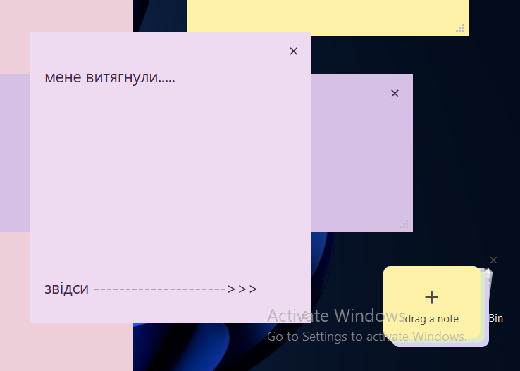
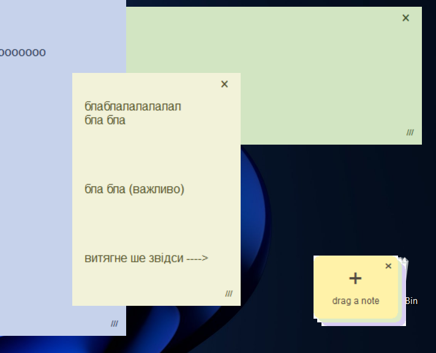

# Sticky Notes — Порівняння кросплатформних фреймворків C++

[Українська](#українська) | [English](#english)

### Qt



### wxWidgets



---

# Українська

## Про проєкт

Цей репозиторій створено в межах курсової роботи на тему **«Порівняльний аналіз фреймворків для розробки кросплатформних додатків мовою C++»**.

Метою роботи є практичне порівняння **Qt** та **wxWidgets** шляхом реалізації одного й того самого настільного застосунку за допомогою обох фреймворків.

Для порівняння розроблено застосунок віртуальних стікерів, орієнтований на швидку роботу з короткими нотатками без необхідності відкривати повноцінний менеджер нотаток.

## Ідея застосунку

Основна концепція відтворює взаємодію зі звичайними паперовими стікерами.

Користувач може:

- створити новий стікер через компактний лаунчер у вигляді стопки паперу;
- витягнути нову нотатку зі стопки перетягуванням;
- розмістити її в будь-якому місці екрана;
- одразу вводити та редагувати текст;
- переміщувати нотатки;
- змінювати їх розмір;
- видаляти окремі стікери.

Нотатки існують як незалежні безрамкові вікна.

## Фреймворки

У межах роботи порівнюються:

- **Qt 6.12**
- **wxWidgets 3.2.12**

Для коректного практичного порівняння в обох реалізаціях створено однаковий базовий набір функцій.

## Поточний стан

Базова функціональність реалізована в **обох фреймворках**.

| Функціональність | Qt | wxWidgets |
| --- | :---: | :---: |
| Створення стікерів | ✅ | ✅ |
| Редагування тексту | ✅ | ✅ |
| Переміщення стікерів | ✅ | ✅ |
| Робота з декількома нотатками | ✅ | ✅ |
| Видалення нотаток | ✅ | ✅ |
| Збереження тексту та позиції | ✅ | ✅ |
| Збереження розміру | ✅ | ✅ |
| Зміна розміру стікерів | ✅ | ✅ |
| Випадкові пастельні кольори | ✅ | ✅ |
| Автоматичний контрастний колір тексту | ✅ | ✅ |
| Збереження кольорів між запусками | ✅ | ✅ |
| Лаунчер у вигляді стопки стікерів | ✅ | ✅ |
| Створення натисканням | ✅ | ✅ |
| Створення перетягуванням зі стопки | ✅ | ✅ |
| Користувацька графіка | Заплановано | Заплановано |
| Анімація зминання під час видалення | Заплановано | Заплановано |

Таким чином, обидві реалізації досягли **функціонального паритету базового рівня**, необхідного для практичного порівняння фреймворків.

## Реалізована базова функціональність

Обидві версії підтримують:

- безрамкові стікери у вигляді незалежних вікон;
- безпосереднє введення та редагування тексту;
- переміщення нотаток по робочому столу;
- одночасну роботу з декількома стікерами;
- зміну розміру;
- видалення;
- збереження стану між запусками;
- збереження тексту, позиції, розміру та кольорів;
- випадкову генерацію пастельних кольорів;
- автоматичний вибір читабельного кольору тексту;
- компактний безрамковий лаунчер;
- створення нового стікера натисканням;
- створення нового стікера перетягуванням зі стопки.

## Структура репозиторію

```text
StickyNotes_Frameworks/
├── qt/
│   ├── src/
│   ├── CMakeLists.txt
│   └── README.md
│
├── wxwidgets/
│   ├── src/
│   ├── CMakeLists.txt
│   └── README.md
│
├── docs/
│   ├── comparison.md
│   ├── development-notes.md
│   ├── screenshots/
│   └── videos/
│
├── CMakeLists.txt
├── CMakePresets.json
└── README.md
```

## Основні критерії порівняння

У процесі розробки аналізуються:

- складність початкового налаштування;
- інтеграція залежностей;
- структура та обсяг коду;
- створення та керування вікнами;
- обробка подій миші;
- робота з текстовими елементами;
- зміна розміру вікон;
- кастомізація інтерфейсу;
- власне малювання елементів;
- робота з кольорами;
- збереження стану застосунку;
- можливості для майбутньої анімації;
- кросплатформність;
- процес збирання та розгортання.

Детальні спостереження зібрані у [`docs/comparison.md`](docs/comparison.md).

## Середовище розробки

Поточна конфігурація:

- C++20;
- Visual Studio 2026;
- MSVC v143;
- CMake;
- Qt 6.12 MSVC 2022 64-bit;
- wxWidgets 3.2.12;
- Windows x64.

Qt встановлюється окремо та підключається через `find_package`.

wxWidgets завантажується і збирається з вихідного коду через CMake `FetchContent`.

## Збирання

### Конфігурація

```powershell
cmake --preset windows-vs2026-v143
```

### Qt

```powershell
cmake --build --preset debug
```

Запуск:

```powershell
.\build\qt\Debug\StickyNotesQt.exe
```

### wxWidgets

```powershell
cmake --build --preset wx-debug
```

Запуск:

```powershell
.\build\wxwidgets\Debug\StickyNotesWx.exe
```

## Заплановані покращення

Після досягнення функціонального паритету подальша робота може бути зосереджена на візуальному оформленні:

- власна графіка для стопки стікерів;
- відображення кольору наступного стікера до його створення;
- черга з трьох видимих кольорів майбутніх нотаток;
- автоматичне зміщення кольорів у стопці після витягування верхнього стікера;
- більш виразний візуальний ефект захоплення нотатки курсором;
- користувацькі графічні ресурси;
- анімація зминання паперу під час видалення;
- фінальне візуальне полірування обох реалізацій.

---

# English

## About the Project

This repository was created as part of a coursework project titled **“Comparative Analysis of Frameworks for Cross-Platform Application Development in C++.”**

The goal is to provide a practical comparison of **Qt** and **wxWidgets** by implementing the same desktop application with both frameworks.

The comparison application is a virtual sticky-note system designed for fast interaction with short notes without requiring a conventional full-size notes manager.

## Application Idea

The main concept reproduces the interaction of physical sticky notes.

The user can:

- create a note through a compact paper-stack launcher;
- pull a new note out of the stack by dragging;
- place it anywhere on the screen;
- immediately enter and edit text;
- move notes independently;
- resize them;
- delete individual notes.

Each sticky note operates as an independent frameless window.

## Frameworks

The coursework compares:

- **Qt 6.12**
- **wxWidgets 3.2.12**

The same baseline functionality has been implemented in both frameworks to provide a fair practical comparison.

## Current Status

The core functionality is implemented in **both versions**.

| Feature | Qt | wxWidgets |
| --- | :---: | :---: |
| Sticky-note creation | ✅ | ✅ |
| Text editing | ✅ | ✅ |
| Window dragging | ✅ | ✅ |
| Multiple notes | ✅ | ✅ |
| Note deletion | ✅ | ✅ |
| Persistent text and position | ✅ | ✅ |
| Persistent dimensions | ✅ | ✅ |
| Note resizing | ✅ | ✅ |
| Random pastel colors | ✅ | ✅ |
| Automatic contrasting text color | ✅ | ✅ |
| Persistent colors | ✅ | ✅ |
| Paper-stack launcher | ✅ | ✅ |
| Click-to-create | ✅ | ✅ |
| Drag-to-create | ✅ | ✅ |
| Custom artwork | Planned | Planned |
| Paper-crumpling deletion animation | Planned | Planned |

The two implementations have therefore reached **core functional parity**, providing a complete baseline for the framework comparison.

## Implemented Baseline

Both versions support:

- independent frameless sticky-note windows;
- direct text entry and editing;
- note movement across the desktop;
- multiple simultaneous notes;
- resizing;
- individual deletion;
- persistent application state;
- persistent text, position, dimensions, and colors;
- random pastel palette generation;
- automatically generated readable text colors;
- a compact frameless launcher;
- click-to-create interaction;
- drag-to-create interaction.

## Repository Structure

```text
StickyNotes_Frameworks/
├── qt/
│   ├── src/
│   ├── CMakeLists.txt
│   └── README.md
│
├── wxwidgets/
│   ├── src/
│   ├── CMakeLists.txt
│   └── README.md
│
├── docs/
│   ├── comparison.md
│   ├── development-notes.md
│   ├── screenshots/
│   └── videos/
│
├── CMakeLists.txt
├── CMakePresets.json
└── README.md
```

## Main Comparison Criteria

The development process is used to compare:

- initial project setup;
- dependency integration;
- code structure and complexity;
- window creation and management;
- mouse-event handling;
- text controls;
- resizing;
- interface customization;
- custom drawing;
- color handling;
- application-state persistence;
- potential animation support;
- cross-platform capabilities;
- build and deployment workflow.

Detailed observations are recorded in [`docs/comparison.md`](docs/comparison.md).

## Development Environment

The project currently uses:

- C++20;
- Visual Studio 2026;
- MSVC v143;
- CMake;
- Qt 6.12 MSVC 2022 64-bit;
- wxWidgets 3.2.12;
- Windows x64.

Qt is installed separately and located through `find_package`.

wxWidgets is downloaded and built from source using CMake `FetchContent`.

## Building

### Configure

```powershell
cmake --preset windows-vs2026-v143
```

### Qt

```powershell
cmake --build --preset debug
```

Run:

```powershell
.\build\qt\Debug\StickyNotesQt.exe
```

### wxWidgets

```powershell
cmake --build --preset wx-debug
```

Run:

```powershell
.\build\wxwidgets\Debug\StickyNotesWx.exe
```

## Planned Improvements

After reaching functional parity, further development can focus on visual refinement:

- custom artwork for the paper-stack launcher;
- previewing the next note color before creation;
- a visible three-color queue of future notes;
- shifting stack colors after the top note is removed;
- stronger visual feedback while grabbing a note;
- replaceable custom visual assets;
- a paper-crumpling deletion animation;
- final visual polish for both implementations.